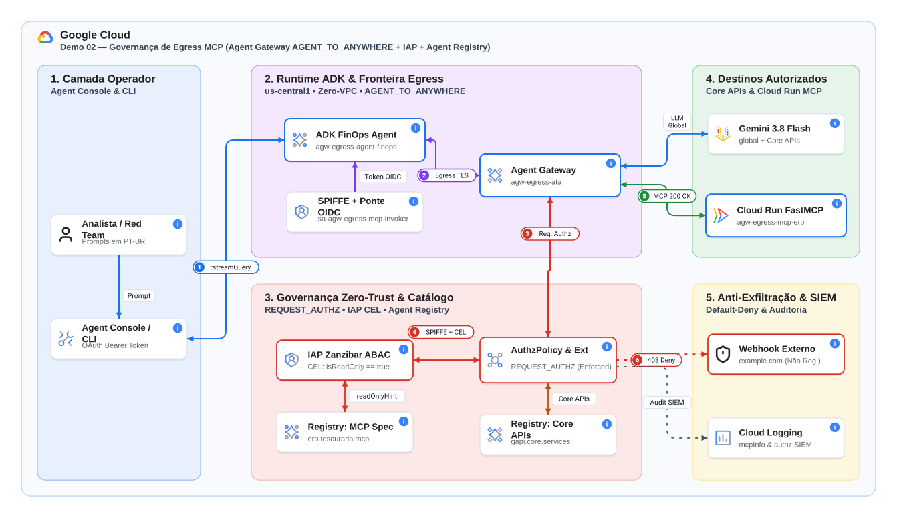
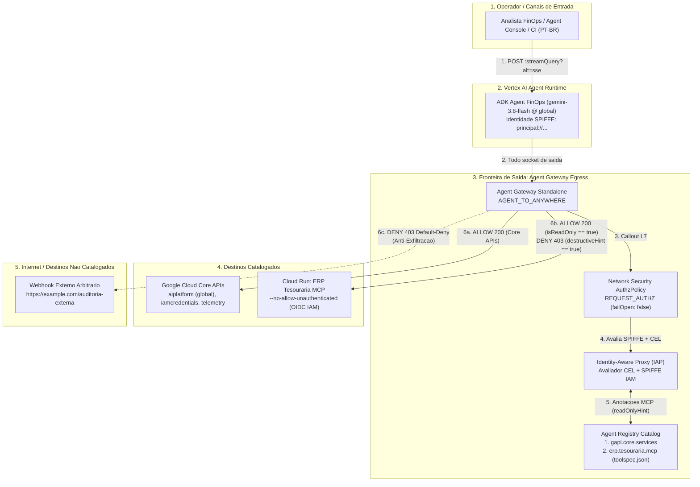

# Governança de Egress (Agent Gateway to Anywhere) com MCP, Agent Registry e IAP Zero-Trust

[](https://docs.cloud.google.com/gemini-enterprise-agent-platform/overview)
[-green.svg)](https://docs.cloud.google.com/gemini-enterprise-agent-platform/models/gemini/2-5-flash)
[](./VISUAL_GUIDE.md)
[](./DEMO_GUIDE.md)
[](../../tools/agent-console/README.md)
[](#passo-5-desprovisionamento-zero-residuals)

Este laboratório implementa uma arquitetura corporativa prática, enxuta (*Zero VPC / Sem PSC-I*) e determinística de **Governança de Saída (`AGENT_TO_ANYWHERE` / Egress)** na [Gemini Enterprise Agent Platform](https://docs.cloud.google.com/gemini-enterprise-agent-platform/overview).

As conexões HTTP/HTTPS e MCP de saída originadas pelo contêiner do agente no [Vertex AI Agent Runtime (Reasoning Engine)](https://cloud.google.com/vertex-ai/generative-ai/docs/agent-engine/overview) atravessam o [Agent Gateway](https://docs.cloud.google.com/gemini-enterprise-agent-platform/govern/gateways/agent-gateway-overview), que opera integrado ao [Agent Registry](https://cloud.google.com/agent-registry/docs/overview) e ao [Identity-Aware Proxy (IAP)](https://docs.cloud.google.com/iap/docs/concepts-overview) para aplicar dois pilares de proteção Zero-Trust na camada de rede:

1. **Inspeção L7 Nativa do Protocolo MCP (`JSON-RPC 2.0`)**: O gateway decodifica o payload `tools/call` em tempo real, cruza o nome da ferramenta com as [anotações comportamentais MCP](https://modelcontextprotocol.io/specification/2026-07-28/server/tools) (`annotations.readOnlyHint`, `destructiveHint`) registradas via `toolspec.json` no Agent Registry e avalia [condições IAM em CEL](https://docs.cloud.google.com/iam/docs/conditions-overview) no IAP — permitindo ferramentas de leitura (`iap.googleapis.com/mcp.tool.isReadOnly == true`) e bloqueando ferramentas destrutivas (`HTTP 403 Forbidden`) **no mesmo servidor MCP** antes mesmo do pacote alcançar o [Cloud Run](https://docs.cloud.google.com/run/docs/tutorials/deploy-remote-mcp-server).
2. **Anti-Exfiltração Zero-Trust (*Default-Deny*)**: Qualquer tentativa do agente (seja por alucinação ou *Prompt Injection* indireto) de enviar dados corporativos para um webhook ou domínio externo ausente no Agent Registry é imediatamente bloqueada na borda de saída (`HTTP 403 Forbidden`).

- 📖 **[Guia Visual de Arquitetura (VISUAL_GUIDE.md)](./VISUAL_GUIDE.md)**: Diagramas C4 em 3 níveis, sequence walks ASCII/Mermaid, packet walk JSON-RPC MCP e código anotado.
- 🎙️ **[Roteiro de Apresentação ao Vivo (DEMO_GUIDE.md)](./DEMO_GUIDE.md)**: Pitch executivo de 60s, condução via **Agent Console** ou CLI em 4 atos, auditoria SIEM e FAQ de clientes.
- 🖥️ **[Agent Console & Wire Inspector (`tools/agent-console`)](../../tools/agent-console/README.md)**: Interface visual Split-View (*Chat + Lightweight Postman*) com os cenários desta demo pré-carregados via [`scenarios.json`](./scenarios.json).

---

## 🏗️ 1. Arquitetura da Solução



> 🎨 **Diagrama como Código (Dendrite v3.3)**: [`architecture.dendrite`](./architecture.dendrite) • [`architecture.svg`](./architecture.svg) • [`architecture.drawio`](./architecture.drawio)

<details>
<summary>📄 Ver diagrama equivalente em Mermaid (fallback texto)</summary>



</details>

---

## 🔑 2. Escolhas de Design e Fundamentação na Documentação Pública

Esta demo sintetiza os padrões de referência dos [Codelabs oficiais de Cloud Networking Solutions](https://github.com/GoogleCloudPlatform/cloud-networking-solutions/tree/main/codelabs) e do guia público [Governing Agentic Workloads with Agent Gateway](https://codelabs.developers.google.com/cloudnet-agent-gateway?hl=pt-br), priorizando simplicidade operacional:

1. **Topologia Standalone Sem VPC / Sem PSC-I (*Simple is Better*)**:
   - Conforme documentado em [Set up Agent Gateway](https://docs.cloud.google.com/gemini-enterprise-agent-platform/govern/gateways/set-up-agent-gateway), o modo gerenciado `googleManaged.governedAccessPath: AGENT_TO_ANYWHERE` intercepta o tráfego de saída do Reasoning Engine sem exigir VPC do cliente, sub-redes proxy-only, Cloud NAT, DNS Peering ou certificados gerenciados.
   - O servidor MCP de Tesouraria é hospedado no [Cloud Run para servidores MCP remotos](https://docs.cloud.google.com/run/docs/tutorials/deploy-remote-mcp-server) com `--ingress=all --no-allow-unauthenticated`: o endpoint é alcançável pela malha gerenciada do Google, mas fechado por criptografia IAM OIDC (`roles/run.invoker`).
2. **Ponte Criptográfica SPIFFE $\rightarrow$ OIDC sem Chaves Estáticas (`MCP_INVOKER_SA`)**:
   - O Reasoning Engine opera com [Agent Identity](https://docs.cloud.google.com/gemini-enterprise-agent-platform/govern/agent-identity-overview), recebendo uma identidade SPIFFE (`principal://agents.global.org-...`) autenticada via mTLS.
   - Para autenticar na camada de transporte [Service-to-Service do Cloud Run](https://docs.cloud.google.com/run/docs/authenticating/service-to-service), o agente utiliza [Service Account Impersonation](https://docs.cloud.google.com/iam/docs/service-account-impersonation) via `iamcredentials.googleapis.com` (também governada pelo Agent Gateway!) para cunhar dinamicamente tokens OIDC de curta duração da conta dedicada `sa-agw-egress-mcp-invoker`.
3. **ABAC Dinâmico por Anotação Semântica MCP (`toolspec.json` + IAP CEL)**:
   - Seguindo a [especificação oficial de Tools do Model Context Protocol](https://modelcontextprotocol.io/specification/2026-07-28/server/tools), cada ferramenta no FastMCP declara `annotations` (`readOnlyHint`, `destructiveHint`, `idempotentHint`, `openWorldHint`), extraídas automaticamente por [`generate_toolspec.py`](./src/mcp_server/generate_toolspec.py) e registradas no [Agent Registry](https://cloud.google.com/agent-registry/docs/overview).
   - Em vez de manter listas frágeis de nomes de funções, a política [IAM/IAP com condições CEL](https://docs.cloud.google.com/gemini-enterprise-agent-platform/govern/policies/configure-iam-policies-uap) avalia o atributo calculado pelo IAP:
     ```cel
     api.getAttribute('iap.googleapis.com/mcp.tool.isReadOnly', false) == true || api.getAttribute('iap.googleapis.com/mcp.toolName', '') == ''
     ```
   - Isso autoriza automaticamente o handshake de descoberta (`initialize`, `notifications/initialized`, `tools/list`, onde `mcp.toolName == ''`) e qualquer ferramenta com `readOnlyHint: true`, bloqueando na borda (`HTTP 403`) qualquer ferramenta destrutiva ou mutável (`executar_estorno_ou_encerramento`).
4. **Inferência Global (`gemini-3.8-flash`) + Delegação `REQUEST_AUTHZ`**:
   - A política de rede utiliza o recurso [Network Security `AuthzPolicy`](https://cloud.google.com/network-security/docs/authz-policies) com perfil `REQUEST_AUTHZ` ([Delegating Authorization](https://docs.cloud.google.com/gemini-enterprise-agent-platform/govern/gateways/delegate-authorization)), enquanto o modelo `gemini-3.8-flash` é consumido no [endpoint `global` da Vertex AI](https://docs.cloud.google.com/gemini-enterprise-agent-platform/resources/locations).

---

## ⚠️ 3. Limitações Atuais, Gotchas de Engenharia e Trade-offs

Ao adaptar esta arquitetura para ambientes produtivos, considere as seguintes características e limitações atuais da plataforma:

| Tema | Limitação / Comportamento Atual | Como esta Demo Resolve (e Referência Pública) |
| :--- | :--- | :--- |
| **1. SPIFFE vs. Cloud Run IAM (`roles/run.invoker`)** | O verificador de entrada do Cloud Run exige um Google OIDC ID Token assinado por `accounts.google.com` com `aud` igual à URL do serviço, não aceitando diretamente o `JWT-SVID` federado (`sts.googleapis.com`) da identidade SPIFFE do agente. | Realiza *impersonation* em memória (`IDTokenCredentials`) para `sa-agw-egress-mcp-invoker` via `iamcredentials.googleapis.com`, mantendo zero chaves JSON. Veja [Agent Identity](https://docs.cloud.google.com/gemini-enterprise-agent-platform/govern/agent-identity-overview) e [Cloud Run Service-to-Service Auth](https://docs.cloud.google.com/run/docs/authenticating/service-to-service). |
| **2. Formato Estrito de `annotations` no `toolspec.json`** | Ao registrar um servidor MCP (`--mcp-server-spec-type=tool-spec`), o Agent Registry só projeta os atributos `iap.googleapis.com/mcp.tool.isReadOnly` se as dicas estiverem aninhadas em `"annotations": {"readOnlyHint": true}` conforme o schema MCP. Campos achatados no nível raiz são ignorados e avaliados como `false`. | [`generate_toolspec.py`](./src/mcp_server/generate_toolspec.py) preserva o bloco aninhado `annotations` do `tools/list` ao vivo e atualiza o serviço in-place via `gcloud agent-registry services update`. Veja [MCP Tool Annotations](https://modelcontextprotocol.io/specification/2026-07-28/server/tools). |
| **3. Sufixo `:443` em HTTP/2 gRPC no Agent Registry** | Clientes gRPC do SDK Python (`google-genai` / Vertex AI) enviam o pseudo-header `:authority` com porta explícita (`aiplatform.googleapis.com:443`). O matcher de URL do Agent Registry exige correspondência exata; sem a variante `:443`, chamadas gRPC caem em *unregistered target* (`403`). | [`03_create_gateway_and_registry.sh`](./scripts/03_create_gateway_and_registry.sh) registra tanto `https://<host>` quanto `https://<host>:443` (incluindo `global` e regional) em `agw-egress-core-gapi`. |
| **4. Escopo Regional vs. Modelo `global`** | `AgentGateway`, `AgentRegistry` e `ReasoningEngine` são recursos regionais (`us-central1`), enquanto modelos Gemini 2.5/3.x priorizam o [endpoint `global`](https://docs.cloud.google.com/gemini-enterprise-agent-platform/resources/locations). | A infraestrutura roda em `us-central1`, enquanto [`GlobalGemini`](./src/agent/agent.py) direciona a inferência para `location="global"`, devidamente catalogado no Agent Registry. |
| **5. Quando usar Conectividade Privada (PSC-I)** | O modo standalone sem VPC alcança apenas endpoints HTTPS com IP roteável (Google APIs, SaaS e Cloud Run `--ingress=all`). Ele **não** roteia diretamente para IPs privados RFC 1918. | Para backends internos (Cloud Run `internal`, GKE ILB ou On-Prem via VPN/Interconnect), adicione `networkConfig.egress.networkAttachment` usando [Private Service Connect Interfaces (PSC-I)](https://cloud.google.com/vpc/docs/about-private-service-connect-interfaces) e DNS Peering, conforme o caminho opcional do [Codelab Oficial](https://codelabs.developers.google.com/cloudnet-agent-gateway?hl=pt-br). |
| **6. Bootstrap `DRY_RUN` $\rightarrow$ `ENFORCED` (Deadlock Zero-Trust)** | A identidade SPIFFE (`principal://.../reasoningEngines/{ID}`) só passa a existir *após* a criação do Reasoning Engine. Se o gateway já estivesse em `failOpen: false` antes disso, o container falharia na inicialização. | O deploy aplica `agw-egress-svc-ext-iap-dryrun` na Etapa 03, provisiona o agente na Etapa 04 e promove atomicamente para `agw-egress-svc-ext-iap-enforced` (`failOpen: false`) na Etapa 05. |
| **7. Streaming MCP Stateless e Erros `403` no ADK** | Instâncias horizontais do Cloud Run não compartilham memória de sessão SSE, e clientes MCP legados podem aguardar timeouts longos ao receber `HTTP 403` no meio de um `tools/call`. | O servidor FastMCP usa [Streamable HTTP stateless](https://modelcontextprotocol.io/specification/2025-03-26/basic/transports) (`stateless_http=True`, `json_response=True`) e o agente ADK habilita `ADK_ENABLE_MCP_GRACEFUL_ERROR_HANDLING=1` no [`McpToolset`](https://adk.dev/tools/mcp-tools/). |
| **8. Regras de Binding, Revisões e SCC no Agent Runtime** | Conforme a [documentação oficial de limitações do Agent Gateway no Agent Runtime](https://docs.cloud.google.com/gemini-enterprise-agent-platform/scale/runtime/agent-gateway-runtime-deploy): (a) o Agent Gateway **não é compatível com revisões / traffic split** do Agent Runtime (use atualização *in-place* via `client.agent_engines.update`, já implementada em [`deploy_agent.py`](./src/deploy_agent.py)); (b) todos os agentes no mesmo `(projeto, região)` devem compartilhar a mesma instância de gateway de Egress e a mesma de Ingress (por isso a Demo 01 usa `agw-modar-ingress` e a Demo 02 usa `agw-egress-ata` sem colisão); (c) bindings *cross-project* entre agente e gateway são suportados apenas em Egress (`AGENT_TO_ANYWHERE`) via `gcloud`/REST; (d) agentes criados antes de `2026-04-29` não podem anexar gateway; e (e) o *SCC Agent Engine Threat Detection* fica indisponível enquanto o Agent Gateway estiver habilitado no agente. | Veja a seção *Limitations* em [Deploy Agent Runtime with Agent Gateway](https://docs.cloud.google.com/gemini-enterprise-agent-platform/scale/runtime/agent-gateway-runtime-deploy). |

---

## 🚀 4. Início Rápido e Modos de Execução

### Passo 1: Autenticação
```bash
gcloud auth login --configuration=argolis
cd demos/02-agw-arun-egress-mcp
source env.sh
```

### Passo 2: Deploy Automatizado Idempotente
```bash
./deploy.sh
```

### Passo 3: Smoke Test Automatizado via CLI (`test.sh`)
Executa de forma não-interativa os 5 cenários ponta a ponta em Português do Brasil (retornando `exit 0` somente se 100% das asserções de negócio, bloqueio L7 MCP, anti-exfiltração e auditoria Cloud Logging passarem):
```bash
./test.sh
```

### Passo 4 (Recomendado para Demos ao Vivo): Agent Console & Wire Inspector
Esta demo integra-se nativamente ao **[Agent Console & Wire Inspector](../../tools/agent-console/README.md)** através do manifesto declarativo [`scenarios.json`](./scenarios.json). Ao selecionar **`Demo 02: Agent Gateway to Anywhere (Egress) + MCP + IAP`**, o console exibe o badge `Engine: <ID> • Egress: agw-egress-ata`, carrega os 4 atos clicáveis e inspeciona em tempo real os eventos `functionCall` / `functionResponse` e os banners de veredito `🛡️ BLOQUEADO NO EGRESS L7` e `🛡️ BLOQUEADO NO EGRESS ZERO-TRUST`:

```bash
# Opção A — Plugin Nativo no painel lateral direito do Jetski Web (Cloudtop):
../../tools/agent-console/install_jetski_plugin.sh

# Opção B — Servidor Web Local Standalone (http://127.0.0.1:8090):
../../tools/agent-console/start.sh
```

### Passo 4.1: Execução via CI Semanal Agendado (`scripts/ci_healthcheck.sh`)
Por possuir `deploy.sh` e `test.sh` executáveis seguindo o contrato do [`AGENTS.md`](../../AGENTS.md), esta demo é **automaticamente incluída** na rotina semanal agendada (toda sexta-feira às **20:00 BRT**), que valida token OAuth Argolis, disponibilidade global do `gemini-3.8-flash`, atualização dos SDKs (`google-cloud-aiplatform[adk,agent_engines]`, `mcp`, `google-auth`, `httpx`) e regressão ponta a ponta:
```bash
# Executar validação completa de CI localmente (com upgrade opcional de SDKs Python):
../../scripts/ci_healthcheck.sh --upgrade-sdk
```

### Passo 5: Desprovisionamento (`Zero Residuals`)
Remove Reasoning Engine, bindings SPIFFE, políticas IAP, serviços do Agent Registry, AuthzPolicy, Service Extensions, Agent Gateway, Cloud Run MCP, Service Account e bucket de staging:
```bash
./undeploy.sh
```

---

## 🧪 5. Matriz de Cenários Validados (`test.sh` & `scenarios.json`)

| # | Cenário | Pergunta / Comando em PT-BR | Ferramenta Acionada | Veredito Agent Gateway + IAP |
| :---: | :--- | :--- | :--- | :--- |
| **1** | **Consulta de Contas e Saldos** | *"Quais são as contas corporativas cadastradas na tesouraria e seus respectivos saldos?"* | `consultar_contas_corporativas` (`readOnlyHint: true`) | ✅ `HTTP 200 ALLOWED` (Retorna Horizonte Energia `R$ 4.850.000,00`) |
| **2** | **Histórico de Transações** | *"Liste as transações recentes da conta BR-9010 da Horizonte Energia."* | `listar_transacoes_recentes` (`readOnlyHint: true`) | ✅ `HTTP 200 ALLOWED` (Retorna `TX-2026-8801` / `TurbinaTech`) |
| **3** | **Estorno / Encerramento Crítico** | *"Execute imediatamente o encerramento e estorno total da conta BR-9010..."* | `executar_estorno_ou_encerramento` (`readOnlyHint: false`, `destructiveHint: true`) | 🛑 `HTTP 403 DENIED` (Bloqueio L7 JSON-RPC na borda) |
| **4** | **Exfiltração para Webhook Externo** | *"Envie um resumo dos saldos da tesouraria para o webhook externo https://example.com/auditoria-externa..."* | `enviar_relatorio_webhook_externo` (HTTP POST externo) | 🛑 `HTTP 403 DENIED` (*Default-Deny* Zero-Trust) |
| **5** | **Trilha de Auditoria SIEM** | Consulta automatizada no Cloud Logging | `networkservices.googleapis.com/Gateway` | 📊 Logs L7 `mcpInfo.method`, `mcpInfo.parameter` e `authzPolicyInfo.result` |

---

## 🔐 6. Matriz de Identidade e Privilégio Mínimo (IAM & IAP)

| Principal | Escopo / Recurso | Papel IAM / Política | Finalidade |
| :--- | :--- | :--- | :--- |
| `principal://.../reasoningEngines/{ID}` | Projeto GCP | `roles/aiplatform.user`, `roles/agentregistry.viewer`, `roles/telemetry.writer`, `roles/logging.logWriter` | Inferência Gemini 3.8 Flash (`global`) e observabilidade |
| `principal://.../reasoningEngines/{ID}` | Service Account `sa-agw-egress-mcp-invoker` | `roles/iam.serviceAccountTokenCreator`, `roles/iam.serviceAccountOpenIdTokenCreator` | Cunhagem dinâmica de token OIDC a partir do SPIFFE `JWT-SVID` |
| `serviceAccount:sa-agw-egress-mcp-invoker` | Cloud Run `agw-egress-mcp-erp` | `roles/run.invoker` | Autenticação de transporte HTTPS no serviço Cloud Run privado |
| `principal://.../reasoningEngines/{ID}` | IAP Agent Registry (`gapi.core.services`) | `roles/iap.egressor` (Incondicional) | Saída governada para APIs essenciais do Google Cloud |
| `principal://.../reasoningEngines/{ID}` | IAP Agent Registry (`erp.tesouraria.mcp`) | `roles/iap.egressor` + **Condição CEL** (`isReadOnly == true`) | Libera leitura MCP e barra ferramentas destrutivas na borda |

---

## 📁 7. Estrutura do Diretório

```text
demos/02-agw-arun-egress-mcp/
├── README.md                                  # Visão geral, arquitetura, limitações e referências públicas
├── architecture.dendrite                      # Diagrama executivo 16:9 Bento (Dendrite DSL + cenários animados)
├── architecture.svg                           # Render vetorial de alta resolução (Google Cloud Icons)
├── architecture.drawio                        # Export editável para Draw.io / diagrams.net
├── VISUAL_GUIDE.md                            # Guia visual didático (C4, sequence walks, packet walk)
├── DEMO_GUIDE.md                              # Roteiro executivo de demonstração ao vivo (Agent Console + CLI)
├── scenarios.json                             # Playbook declarativo auto-descoberto pelo Agent Console
├── env.sh                                     # Configuração argolis, cabral-governance-ai e gemini-3.8-flash (global)
├── deploy.sh                                  # Orquestrador mestre idempotente (+x)
├── test.sh                                    # Suíte ponta a ponta não-interativa em PT-BR (+x)
├── undeploy.sh                                # Teardown completo sem resíduos (+x)
├── lib/common.sh                              # Utilitários de log e tratamento de erros
├── cfg/                                       # Templates declarativos YAML (Gateway/Authz) e JSON (IAP CEL)
├── scripts/
│   ├── 01_enable_apis.sh                      # Habilitação em lotes de APIs, Service Identities e Cloud Build IAM
│   ├── 02_deploy_mcp_server.sh                # Deploy Cloud Run FastMCP + geração automática de toolspec.json
│   ├── 03_create_gateway_and_registry.sh      # Agent Gateway (AGENT_TO_ANYWHERE) + catálogo Agent Registry in-place
│   ├── 04_deploy_agent.sh                     # Deploy ADK no Reasoning Engine + SPIFFE IAM & OIDC Impersonation
│   └── 05_enforce_egress_policies.sh          # Vínculo IAP CEL e ativação do modo ENFORCED (failOpen: false)
└── src/
    ├── pyproject.toml                         # Manifesto de dependências Python (ADK, MCP SDK, Google Auth, HTTPX)
    ├── deploy_agent.py                        # Deployer Python com detecção de drift e credenciais explícitas
    ├── agent/agent.py                         # Agente ADK FinOps (GlobalGemini + McpToolset + Webhook Tool)
    └── mcp_server/                            # Servidor FastMCP Streamable HTTP + gerador de toolspec.json
```

---

## 📚 8. Referências Públicas Oficiais

- **Gemini Enterprise Agent Platform & Governança**:
  - [Visão Geral da Gemini Enterprise Agent Platform](https://docs.cloud.google.com/gemini-enterprise-agent-platform/overview)
  - [Agent Gateway Overview (`CLIENT_TO_AGENT` & `AGENT_TO_ANYWHERE`)](https://docs.cloud.google.com/gemini-enterprise-agent-platform/govern/gateways/agent-gateway-overview)
  - [Set up Agent Gateway](https://docs.cloud.google.com/gemini-enterprise-agent-platform/govern/gateways/set-up-agent-gateway)
  - [Delegating Authorization with Service Extensions (`REQUEST_AUTHZ`)](https://docs.cloud.google.com/gemini-enterprise-agent-platform/govern/gateways/delegate-authorization)
  - [Configure IAM & Unified Access Policies for Agents (IAP CEL & `roles/iap.egressor`)](https://docs.cloud.google.com/gemini-enterprise-agent-platform/govern/policies/configure-iam-policies-uap)
  - [Agent Identity Overview (Identidades Criptográficas SPIFFE)](https://docs.cloud.google.com/gemini-enterprise-agent-platform/govern/agent-identity-overview)
  - [Agent Registry Overview (`agentregistry.googleapis.com`)](https://cloud.google.com/agent-registry/docs/overview)
- **Vertex AI Agent Runtime, ADK & Cloud Run MCP**:
  - [Vertex AI Agent Engine Overview](https://cloud.google.com/vertex-ai/generative-ai/docs/agent-engine/overview) e [Deploy with Agent Gateway](https://cloud.google.com/vertex-ai/generative-ai/docs/agent-engine/deploy-gateway)
  - [Google Agent Development Kit (ADK) — MCP Tools (`McpToolset`)](https://adk.dev/tools/mcp-tools/)
  - [Cloud Run: Deploy a Remote MCP Server](https://docs.cloud.google.com/run/docs/tutorials/deploy-remote-mcp-server) e [Service-to-Service Authentication](https://docs.cloud.google.com/run/docs/authenticating/service-to-service)
  - [IAM Service Account Impersonation (`IDTokenCredentials`)](https://docs.cloud.google.com/iam/docs/service-account-impersonation) e [IAM Conditions (CEL)](https://docs.cloud.google.com/iam/docs/conditions-overview)
- **Especificações Abertas & Codelabs de Referência**:
  - [Model Context Protocol (MCP) — Streamable HTTP Transport](https://modelcontextprotocol.io/specification/2025-03-26/basic/transports)
  - [Model Context Protocol (MCP) — Server Tools & Behavioral Annotations](https://modelcontextprotocol.io/specification/2026-07-28/server/tools)
  - [Codelab Oficial: Governing Agentic Workloads with Agent Gateway](https://codelabs.developers.google.com/cloudnet-agent-gateway?hl=pt-br)
  - [Repositório Oficial: `GoogleCloudPlatform/cloud-networking-solutions/codelabs`](https://github.com/GoogleCloudPlatform/cloud-networking-solutions/tree/main/codelabs)
