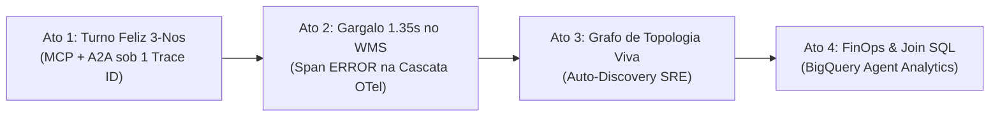

# Guia de Demonstração ao Vivo (Live Demo Playbook): OTel, Topologia Multi-Agente & BigQuery Analytics

Roteiro executivo para arquitetos e engenheiros apresentarem a **Demo 03 (`03-geap-otel-topology-analytics`)** para líderes de SRE, Engenharia de Plataforma, FinOps e Arquitetura Corporativa, utilizando o **[Agent Console & Wire Inspector](../../tools/agent-console/README.md)**, o **Cloud Trace**, o **Agent Topology** e o **BigQuery Studio**.

---

## ⏱️ 1. Pitch Executivo em 60 Segundos

> *"Nas Demos 01 e 02 resolvemos a segurança de **Entrada** (Model Armor + DLP) e de **Saída** (Agent Gateway + IAP MCP). Mas quando colocamos um ecossistema **multi-agente** em produção — onde um Orquestrador no Vertex AI chama servidores MCP de ERP e delega tarefas a outros Agentes Especialistas via protocolo A2A no Cloud Run — surgem três perguntas imediatas do time de Operações e FinOps:*
>
> *1. **Onde está a latência ou o erro?** Se uma resposta demorou 5 segundos, foi o modelo Gemini, foi o protocolo A2A ou foi um lock em uma tabela legada atrás do servidor MCP?*
> *2. **Qual é a topologia real em execução?** Quem está falando com quem agora na minha malha de agentes, sem depender de diagramas estáticos desatualizados?*
> *3. **Quanto custa cada decisão?** Quantos tokens cada agente consumiu, qual a taxa de acerto de cache e quantas vezes ferramentas MCP vs A2A foram acionadas por centro de custo?*
>
> *Nesta demo vamos ver essas três respostas funcionando juntas em tempo real com **OpenTelemetry nativo (`W3C traceparent`)**, **Agent Topology auto-descoberta** e **BigQuery Agent Analytics via Storage Write API** — correlacionados pelo exato mesmo `trace_id`!"*

---

## 🖥️ 2. Preparação Rápida (5 a 10 Minutos antes da Reunião)

1. **Aqueça o Grafo da Aba Topology (Importante!)**:
   - A aba **Topology** exibe conexões `Observability/SENDS_TRAFFIC` exclusivamente com base nos **últimos 60 minutos** de tráfego (janela fixa) e leva **~5 minutos** para materializar novas arestas após o primeiro trace.
   - Se o ambiente ficou sem tráfego na última hora, rode `./test.sh` (ou dispare o **Ato 1** no Agent Console) **5 a 10 minutos antes da call** para que os 3 nós e as setas já estejam desenhados ao abrir a aba.
2. **Abra o Agent Console & Wire Inspector**:
   - No Jetski Web: `../../tools/agent-console/install_jetski_plugin.sh` e abra o painel lateral **🛡️ Agent Console & Wire Inspector**.
   - Ou em navegador local: `../../tools/agent-console/start.sh` (`http://127.0.0.1:8090`).
   - Selecione **`Demo 03: OTel Distribuído, Topologia Multi-Agente Viva & BigQuery Analytics`**.
3. **Deixe 3 abas do Google Cloud Console abertas ao lado** (projeto `cabral-governance-ai`):
   - **Aba 1 — Cloud Trace Explorer**: `https://console.cloud.google.com/traces/explorer?project=cabral-governance-ai`
   - **Aba 2 — Agent Engine / Topology (`o11y-agent-orchestrator`)**: `https://console.cloud.google.com/vertex-ai/agents/agent-engines?project=cabral-governance-ai` *(clique em `o11y-agent-orchestrator` $\rightarrow$ aba **Topology**)*
   - **Aba 3 — BigQuery Studio (`geap_o11y_demo03`)**: `https://console.cloud.google.com/bigquery?project=cabral-governance-ai`

---

## 🎬 3. Roteiro de Apresentação em 4 Atos



---

### Ato 1: Trace Distribuído Costurado em 3 Runtimes (`#PED-9042`)

- **O que falar:** *"Vamos pedir ao Orquestrador para inspecionar o pedido industrial `PED-9042` da Metalúrgica Aurora no ERP e acionar nosso Agente Especialista remoto para calcular a multa contratual de SLA e o plano de mitigação."*
- **No Agent Console:** clique no card **`Ato 1 — Trace Distribuído 3-Nós (Orquestrador -> FastMCP -> Especialista A2A)`**.
- **O que destacar em tela:**
  1. Na aba **`Request`** do Wire Inspector, mostre o cabeçalho `traceparent: 00-<trace_id>-<span_id>-01` injetado automaticamente na requisição.
  2. Na resposta de negócio, o Orquestrador consolida os dados do ERP (`Metalúrgica Aurora S.A.`, `R$ 185.000,00`, `4h` de atraso) com o cálculo do Especialista A2A (`R$ 5.550,00` de multa vs `R$ 2.400,00` de frete dedicado).
  3. Clique no botão azul **`🔗 Cloud Trace (<trace_id>…)`** no topo direito do Wire Inspector!
  4. Na cascata (*Waterfall*) do Cloud Trace que se abre para esse exato `trace_id`, expanda a árvore: mostre na mesma linha do tempo o **Reasoning Engine** (`finops_ops_orchestrator`) $\rightarrow$ o **Cloud Run FastMCP** (`mcp.server/tools/call:consultar_pedido_corporativo` + `erp.postgres_order_lookup`) $\rightarrow$ e o **Cloud Run A2A Agent** (`a2a.specialist/POST /` + `gemini-3.8-flash` + `sla.penalty_matrix_eval`)!

---

### Ato 2: Diagnóstico Instantâneo de Gargalo e Span `ERROR` (`#LOTE-LOCK-503`)

- **O que falar:** *"Agora imagine um incidente real às 15h: a operação de cadeia fria hospitalar reclama que o sistema de agentes ficou lento e um lote de `R$ 410.000,00` da BioFarma está parado. Sem OTel distribuído, culparíamos o LLM. Vamos rodar o diagnóstico."*
- **No Agent Console:** clique no card **`Ato 2 — Diagnóstico de Gargalo & Span ERROR (Lock 1.35s no WMS + Cadeia Fria)`**.
- **Equivalente via cURL:**
  ```bash
  source env.sh
  RE_ID=$(jq -r '.engine_id' .state/agent_info.json)
  TRACE_ID=$(python3 -c "import secrets; print(secrets.token_hex(16))")
  SPAN_ID=$(python3 -c "import secrets; print(secrets.token_hex(8))")

  curl -s -N -X POST \
    "https://${REGION}-aiplatform.googleapis.com/v1/projects/${PROJECT_ID}/locations/${REGION}/reasoningEngines/${RE_ID}:streamQuery?alt=sse" \
    -H "Authorization: Bearer $(gcloud auth print-access-token)" \
    -H "x-goog-user-project: ${PROJECT_ID}" \
    -H "Content-Type: application/json" \
    -H "traceparent: 00-${TRACE_ID}-${SPAN_ID}-01" \
    -d '{"input":{"user_id":"engenheiro-plantao-wms","message":"Concilie o lote logístico LOTE-LOCK-503 no WMS, diagnostique qualquer gargalo técnico de banco de dados e acione o especialista A2A para calcular o risco financeiro de SLA do pedido impactado."}}'

  echo "🔗 Cloud Trace: https://console.cloud.google.com/traces/explorer;traceId=${TRACE_ID}?project=${PROJECT_ID}"
  ```
- **O que destacar no Cloud Trace:**
  - Clique em **`🔗 Cloud Trace`** desse turno: a barra vermelha `erp.legacy_wms_lock_contention` (`1,35 s`, `StatusCode.ERROR`) salta imediatamente aos olhos dentro do serviço `o11y-mcp-erp-ops`, exibindo nos atributos do span `db.sql.table = wms_expedicao_fria`, `erp.lock_holder_pid = 48291` e o evento `db.lock_contention_detected` (`nightly_cold_chain_sync`).
  - Logo abaixo na mesma árvore, o agente A2A calcula o impacto financeiro hospitalar e entrega ao engenheiro de plantão tanto o PID bloqueador quanto a justificativa financeira para frete refrigerado imediato!

---

### Ato 3: Topologia Multi-Agente Viva (`Agent Registry`, `App Hub` & `App Topology`)

- **O que falar:** *"Como implantamos o MCP com `--functional-type=mcp-server` e o Especialista com `--functional-type=agent`, o App Hub e o Agent Registry catalogam as identidades lógicas de cada carga de trabalho, e o App Topology constrói o mapa de dependências automaticamente (`Observability/SENDS_TRAFFIC`, latência p95 e taxa de erro) a partir do tráfego OpenTelemetry dos últimos 60 minutos."*
- **No Console ou Terminal:** abra `Vertex AI -> Agent Engine -> o11y-agent-orchestrator -> Topology` (ou inspecione o grafo via CLI/REST):
  ```bash
  gcloud beta agent-registry mcp-servers list --location=us-central1 --project=cabral-governance-ai
  gcloud beta agent-registry agents list --location=us-central1 --project=cabral-governance-ai

  curl -s -X POST \
    "https://apptopology.googleapis.com/v1/projects/cabral-governance-ai/locations/global/discoveredResourcesTopology:generate" \
    -H "Authorization: Bearer $(gcloud auth print-access-token)" \
    -H "x-goog-user-project: cabral-governance-ai" \
    -H "Content-Type: application/json" \
    -d '{
      "topologyDomains": ["projects/cabral-governance-ai/locations/global/domains/SRE"],
      "filter": {
        "startingNode": {"alias": "anchor", "labelPropertiesPattern": {"labelMatcherExpr": "Base/Agent"}},
        "neighbors": [{
          "edge": {"direction": "ANY", "labelPropertiesPattern": {"labelMatcherExpr": "Observability/SENDS_TRAFFIC"}},
          "graph": {"startingNode": {"alias": "neighbor", "labelPropertiesPattern": {"labelMatcherExpr": "Base/Agent OR Base/MCPServer OR Base/DiscoveredService OR Base/DiscoveredWorkload"}}}
        }]
      }
    }' | jq .
  ```

---

### Ato 4: FinOps em Tempo Real & Proveniência `MCP` vs `A2A` no BigQuery

- **O que falar:** *"Por fim, enquanto o Cloud Trace atende o SRE investigando um incidente individual, o **BigQuery Agent Analytics** grava via Storage Write API cada chamada de modelo e ferramenta em sub-segundo para FinOps, auditoria executiva e correlação em escala."*
- **Execute no BigQuery Studio (ou via `bq query`):**

#### Query 1 — FinOps de Tokens, Cache Hit Rate e Latência por Turno LLM (`v_llm_response`)
```sql
SELECT
  FORMAT_TIMESTAMP('%Y-%m-%d %H:%M:%S', timestamp, 'America/Sao_Paulo') AS horario_brt,
  agent,
  model_version,
  usage_prompt_tokens AS prompt_tok,
  usage_completion_tokens AS output_tok,
  usage_thinking_tokens AS thinking_tok,
  usage_cached_tokens AS cached_tok,
  ROUND(context_cache_hit_rate * 100, 1) AS cache_hit_pct,
  ttft_ms,
  total_ms,
  trace_id
FROM `cabral-governance-ai.geap_o11y_demo03.v_llm_response`
ORDER BY timestamp DESC
LIMIT 15;
```

#### Query 2 — Proveniência de Ferramentas (`MCP` vs `A2A`) e Latência Média (`v_tool_completed`)
```sql
SELECT
  tool_origin,
  tool_name,
  COUNT(*) AS execucoes,
  ROUND(AVG(total_ms), 1) AS latencia_media_ms,
  MAX(total_ms) AS latencia_max_ms
FROM `cabral-governance-ai.geap_o11y_demo03.v_tool_completed`
GROUP BY tool_origin, tool_name
ORDER BY execucoes DESC;
```

#### Query 3 — Join Direto entre Negócio/FinOps (`agent_events`) e Spans de Infraestrutura (`_AllSpans`)
*(Quando o Linked Dataset `geap_o11y_traces_linked` estiver habilitado no bucket `_Trace`):*
```sql
SELECT
  t.trace_id,
  t.tool_origin,
  t.tool_name,
  t.total_ms AS adk_tool_ms,
  s.name AS child_infra_span,
  ROUND(s.duration_nano / 1e6, 1) AS infra_span_ms,
  JSON_VALUE(s.attributes, '$."db.sql.table"') AS locked_table
FROM `cabral-governance-ai.geap_o11y_demo03.v_tool_completed` AS t
JOIN `cabral-governance-ai.geap_o11y_traces_linked._AllSpans` AS s
  ON t.trace_id = s.trace_id
WHERE s.name LIKE 'erp.%' OR s.name LIKE 'sla.%'
ORDER BY t.timestamp DESC
LIMIT 20;
```

---

## ❓ 4. FAQ Executivo (Perguntas Frequentes de Clientes)

1. **"Onde ficam os textos completos dos prompts se `CAPTURE_MESSAGE_CONTENT=NO_CONTENT` está ativo nos spans?"**
   - Os atributos de span no Cloud Trace têm limite estrito de 256 bytes e são voltados para latência/estrutura operacional. Os prompts e respostas completos são gravados sem truncamento em **dois lugares governados**: (a) em arquivos `.jsonl` no bucket `gs://cabral-governance-ai-o11y-telemetry/completions/` via hook nativo do OpenTelemetry GenAI, e (b) na tabela `geap_o11y_demo03.agent_events` no BigQuery (com offload automático de anexos grandes para GCS), onde você aplica IAM por coluna e retenção LGPD.
2. **"Qual é o impacto de latência do `BigQueryAgentAnalyticsPlugin` na resposta ao usuário?"**
   - Praticamente zero no caminho crítico: o plugin enfileira eventos em memória em uma *thread* assíncrona dedicada (`_BG_LOOP`) usando gRPC **BigQuery Storage Write API**. Nesta demo ativamos `flush_on_run_end=True` e `batch_size=1` para visibilidade imediata em apresentações ao vivo; em alta escala produtiva (>1.000 QPS), basta usar `batch_size=50` e `flush_on_run_end=False`.
3. **"Por que não há juízes de avaliação (`Evaluation`) rodando junto aqui?"**
   - Por separação arquitetural e controle de custos: telemetria OTel e BigQuery Agent Analytics rodam em **100% do tráfego** com custo marginal de armazenamento/streaming, enquanto avaliadores *LLM-as-a-Judge* consomem chamadas adicionais de modelo e devem rodar por amostragem ou em janelas agendadas sobre o dataset já coletado no BigQuery.
4. **"Qual é o papel do App Hub aqui, e por que a aba Topology às vezes mostra `No recent trace connections detected.`?"**
   - O **Cloud Trace** enxerga apenas recursos físicos e efêmeros nos spans (`revisions/o11y-mcp-erp-ops-00002`); o **App Hub** (`apphub.googleapis.com`) é o catálogo estrutural que agrupa essas revisões em *Discovered Services* e *Discovered Workloads* estáveis, permitindo que o **App Topology** desenhe nós de negócio conectados ao **Agent Registry**. Já o aviso `No recent trace connections detected.` ocorre quando não houve tráfego nos **últimos 60 minutos** (janela fixa da aba Topology); após enviar uma nova requisição, aguarde **~5 minutos** para a janela agregadora publicar as arestas.
