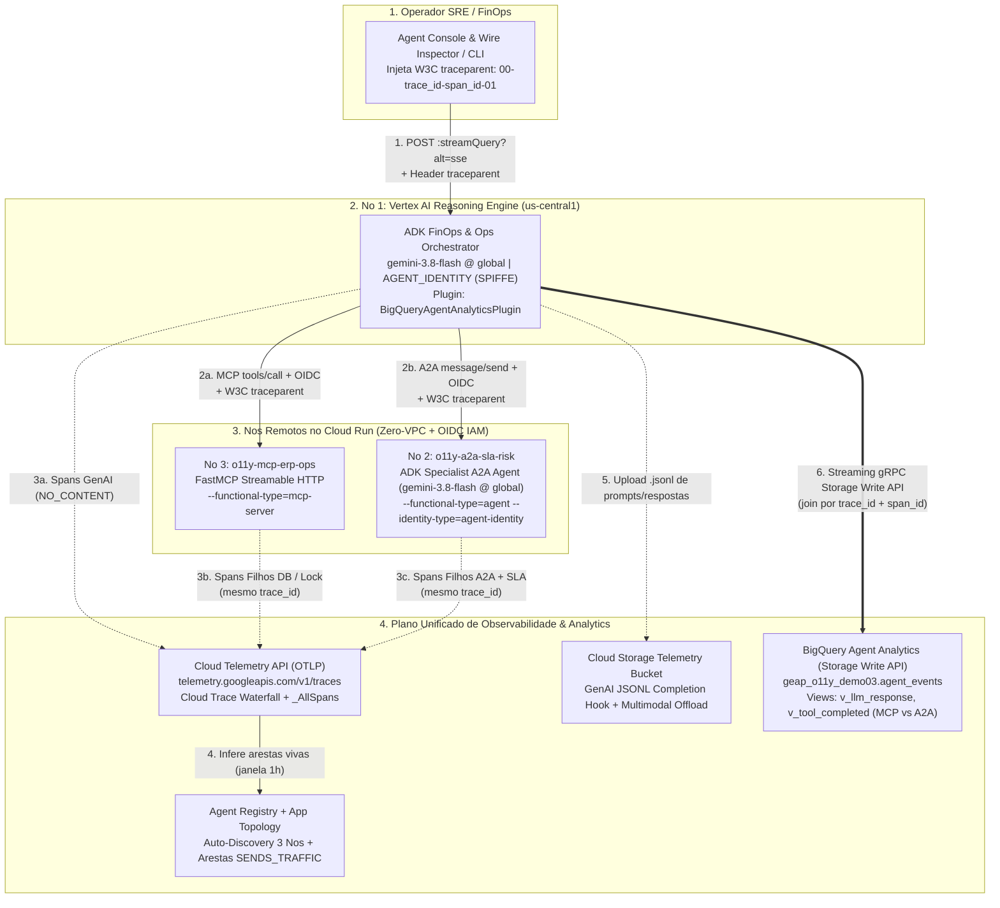

# Observabilidade Ponta a Ponta (OpenTelemetry), Topologia Viva Multi-Agente e BigQuery Agent Analytics

[](https://docs.cloud.google.com/gemini-enterprise-agent-platform/overview)
[-green.svg)](https://docs.cloud.google.com/gemini-enterprise-agent-platform/models/gemini/2-5-flash)
[](./VISUAL_GUIDE.md)
[](./DEMO_GUIDE.md)
[](../../tools/agent-console/README.md)
[](#5-desprovisionamento-zero-residuals)

Este laboratório implementa uma arquitetura enxuta (*Zero VPC*), multi-runtime e 100% reproduzível de **Observabilidade Distribuída OpenTelemetry, Topologia Multi-Agente Viva e FinOps / Telemetria em Tempo Real no BigQuery** na [Gemini Enterprise Agent Platform (GEAP)](https://docs.cloud.google.com/gemini-enterprise-agent-platform/overview) — mantendo **Avaliação de Qualidade (`Evaluation` / LLM-as-a-Judge)** propositalmente separada para uma trilha dedicada.

A solução resolve os três pontos cegos clássicos de sistemas multi-agentes corporativos em produção:

1. **Costura de Trace Distribuído (`W3C traceparent`) entre 3 Runtimes Independentes**: Uma única requisição HTTP ao **Agente Orquestrador** no [Vertex AI Agent Runtime (Reasoning Engine)](https://cloud.google.com/vertex-ai/generative-ai/docs/agent-engine/overview) propaga o cabeçalho `traceparent` tanto para um **Servidor FastMCP** no [Cloud Run](https://docs.cloud.google.com/run/docs/ai/agent-platform-features) (`--functional-type=mcp-server`) quanto para um **Agente Especialista Remoto via Protocolo A2A** no Cloud Run (`--functional-type=agent --identity-type=agent-identity`), unificando todos os spans LLM, JSON-RPC e consultas de banco de dados em uma única cascata (*Waterfall*) no [Cloud Trace](https://docs.cloud.google.com/trace/docs/overview).
2. **Grafo de Topologia Multi-Agente Vivo (`Agent Registry` + `App Topology`)**: Ao adotar os novos tipos funcionais nativos do Cloud Run e identidades SPIFFE (`AGENT_IDENTITY`), os 3 nós (`ReasoningEngine`, `Cloud Run A2A Agent` e `Cloud Run MCP Server`) são descobertos automaticamente no [Agent Registry](https://cloud.google.com/agent-registry/docs/overview) e exibem arestas vivas `Observability/SENDS_TRAFFIC` em [Agent Topology](https://docs.cloud.google.com/gemini-enterprise-agent-platform/govern/topology).
3. **FinOps, Proveniência de Ferramentas e Join SQL em Sub-Segundo (`BigQueryAgentAnalyticsPlugin`)**: O plugin oficial do [ADK para BigQuery Agent Analytics](https://adk.dev/integrations/bigquery-agent-analytics/) transmite assincronamente via **BigQuery Storage Write API** cada turno de modelo, consumo de tokens (`prompt`, `completion`, `thinking`, `cached`), `TTFT`, latência total e a origem exata de cada ferramenta (`tool_origin = 'MCP'` vs `'A2A'`), compartilhando o mesmo `trace_id` e `span_id` do Cloud Trace (`_AllSpans`) e realizando *offload* de completions `.jsonl` para o Cloud Storage.

- 📖 **[Guia Visual de Arquitetura (VISUAL_GUIDE.md)](./VISUAL_GUIDE.md)**: Diagramas C4 em 3 níveis, *sequence walk* ponta a ponta, *packet walk* ASCII do `traceparent` HTTP + MCP `_meta` e código anotado.
- 🎙️ **[Roteiro de Apresentação ao Vivo (DEMO_GUIDE.md)](./DEMO_GUIDE.md)**: Pitch executivo de 60s, condução em 4 atos via **Agent Console** (com link de 1 clique **🔗 Cloud Trace**), queries SQL FinOps prontas e FAQ.
- 🖥️ **[Agent Console & Wire Inspector (`tools/agent-console`)](../../tools/agent-console/README.md)**: Simulador Split-View (*Chat + Postman*) com injeção automática de `traceparent` e botão direto para abrir cada turno no Cloud Trace Explorer.

---

## 🏗️ 1. Arquitetura da Solução



---

## 🔑 2. Escolhas de Design e Fundamentação na Documentação Pública

1. **Topologia Viva Real de 3 Nós via `Agent Registry` + `App Hub` (Sem Gateways Singleton Compartilhados)**:
   - Conforme documentado em [Agent Topology](https://docs.cloud.google.com/gemini-enterprise-agent-platform/govern/topology) e [App Hub Overview](https://cloud.google.com/apphub/docs/overview), o Cloud Trace enxerga apenas URIs físicos em spans (`cloud.resource_id`), enquanto o **App Hub** (`apphub.googleapis.com`) atua como o catálogo estrutural que mapeia revisões/instâncias em *Discovered Workloads* e *Discovered Services* de negócio. Funções Python locais (`FunctionTool`) não geram nós de infraestrutura, e servidores MCP externos registrados manualmente são tratados pelo App Hub como *shared resources* (sem renderização de arestas).
   - Ao implantar os serviços remotos no [Cloud Run com `--functional-type=mcp-server` e `--functional-type=agent`](https://docs.cloud.google.com/run/docs/ai/agent-platform-features), ambos são descobertos nativamente pelo App Hub + Agent Registry como cargas de trabalho de 1ª classe, permitindo que `apptopology.googleapis.com` desenhe as arestas `Observability/SENDS_TRAFFIC` (com latência p95 e taxa de erro) diretamente a partir dos spans OpenTelemetry exportados para `telemetry.googleapis.com`.
   - Zero colisão com as Demos 01 e 02: esta demo não altera os singletons regionais `AgentGateway` (`agw-modar-ingress` e `agw-egress-ata`).
2. **Convenções Semânticas OTel 2026 (`gen_ai_latest_experimental`) + Offload `.jsonl` no GCS**:
   - Seguindo o guia oficial de [Instrumentação de Servidores MCP e Agentes no Cloud Trace](https://docs.cloud.google.com/stackdriver/docs/instrumentation/self-hosted-mcp-servers) e [Agent Engine Trace](https://docs.cloud.google.com/agent-builder/agent-engine/trace), o Orquestrador utiliza `OTEL_SEMCONV_STABILITY_OPT_IN="gen_ai_latest_experimental"`, `OTEL_INSTRUMENTATION_GENAI_CAPTURE_MESSAGE_CONTENT="NO_CONTENT"` e `OTEL_INSTRUMENTATION_GENAI_COMPLETION_HOOK="upload"` (`gs://<TELEMETRY_BUCKET>/completions`).
   - Isso mantém os spans no Cloud Trace leves (respeitando o limite de 256 bytes por atributo de span sem truncamento) enquanto preserva os prompts e respostas completos em arquivos JSONL auditáveis no GCS.
3. **Separação Limpa entre Observabilidade Operacional e Avaliação (`create_eval_views=False`)**:
   - O [`BigQueryAgentAnalyticsPlugin`](https://adk.dev/integrations/bigquery-agent-analytics/) grava eventos estruturados em tempo real (`batch_size=1`, `flush_on_run_end=True`, `enable_otel_correlation=True`) e cria automaticamente as views operacionais (`v_llm_response`, `v_tool_completed`, `v_tool_error`, `v_a2a_interaction`), deixando pipelines de *LLM-as-a-Judge* (`AI.SCORE` / Vertex GenAI Eval) desacoplados.
4. **Enriquecimento Automático de URN do Agent Registry (`gen_ai.main_agent.id`)**:
   - O Agente A2A no Cloud Run inicializa `get_gcp_resource()` e `get_gcp_exporters()` do pacote `google.adk.telemetry.google_cloud`, que detecta metadados do Cloud Run e injeta automaticamente o atributo `gen_ai.main_agent.id = urn:agent:projects-<NUM>:...` exigido pelo Agent Registry para correlacionar telemetria ao catálogo.

---

## ⚠️ 3. Gotchas de Engenharia Verificados na Prática

| Tema | Comportamento da Plataforma | Solução Aplicada nesta Demo |
| :--- | :--- | :--- |
| **1. `NO_CONTENT` + Hook GCS no Reasoning Engine** | Combinar `OTEL_INSTRUMENTATION_GENAI_CAPTURE_MESSAGE_CONTENT="true"` legado com `OTEL_SEMCONV_STABILITY_OPT_IN="gen_ai_latest_experimental"` desativa o hook de upload JSONL para GCS. | Definimos `OTEL_INSTRUMENTATION_GENAI_CAPTURE_MESSAGE_CONTENT="NO_CONTENT"` + `OTEL_INSTRUMENTATION_GENAI_COMPLETION_HOOK="upload"` em [`deploy_agent.py`](./src/deploy_agent.py). |
| **2. Cloud Run `--functional-type=agent` exige SPIFFE + `--no-identity-certificate`** | O tipo funcional `agent` no Cloud Run requer `--identity-type=agent-identity` (identidade federada SPIFFE imutável). Sem `--no-identity-certificate` e `GOOGLE_API_USE_MTLS_ENDPOINT="never"`, o exportador OTLP pode receber `401 Context-Aware Access` ao chamar `telemetry.mtls.googleapis.com`. | [`02_deploy_mcp_and_a2a.sh`](./scripts/02_deploy_mcp_and_a2a.sh) pré-autoriza o principal SPIFFE com `roles/telemetry.writer` + `roles/browser` e implanta com `--no-identity-certificate`. |
| **3. Validação de Origem do `AgentCard` no `RemoteA2aAgent`** | `to_a2a(agent)` gera `http://localhost:8000` por padrão no `agent-card.json`; o `RemoteA2aAgent` valida estritamente que a URL RPC do card é HTTPS e possui a mesma origem da URL de onde o card foi baixado. | Calculamos o host determinístico `<service>-<project_number>.<region>.run.app` em [`env.sh`](./env.sh) e injetamos `PUBLIC_HOST`, `PUBLIC_PORT=443` e `PUBLIC_PROTOCOL=https` no `to_a2a()`. |
| **4. Propagação Dupla de `traceparent` (HTTP Header + MCP `_meta`)** | Clientes HTTP e clientes MCP transportam contexto W3C por canais distintos (`traceparent` HTTP vs `params._meta.traceparent` no JSON-RPC). | [`agent.py`](./src/agent/agent.py) injeta `propagate.inject(headers)` nos interceptors OIDC de MCP e A2A, e [`mcp_server/server.py`](./src/mcp_server/server.py) extrai de ambos! |
| **5. Janela Fixa de 60 Minutos + Lag de ~5 Minutos na Aba `Topology`** | A aba **Topology** renderiza arestas `Observability/SENDS_TRAFFIC` exclusivamente a partir dos **últimos 60 minutos** de tráfego (janela não configurável) e o pipeline do Cloud Trace publica arestas em janelas móveis de **~5 minutos**. Após >1h sem tráfego, a tela exibe `No recent trace connections detected.`. | Execute [`./test.sh`](./test.sh) (ou dispare um cenário no `agent-console`) **5 a 10 minutos antes** de demonstrar a aba **Topology** ao vivo. |
| **6. Pinagem Dinâmica `google-adk` 2.x no Reasoning Engine & DNS Rebinding no FastMCP** | A imagem base do Reasoning Engine pré-instala versões antigas (`google-adk` 1.x) em `system-site-packages` (quebrando `google.adk.a2a`), e o `FastMCP` (`mcp>=1.26`) retorna `421 Misdirected Request` em domínios `*.run.app` com proteção padrão de DNS rebinding. | [`deploy_agent.py`](./src/deploy_agent.py) fixa versões exatas via `importlib.metadata.version(...)`, e [`mcp_server/server.py`](./src/mcp_server/server.py) configura `TransportSecuritySettings(enable_dns_rebinding_protection=False)`. |

---

## 🚀 4. Início Rápido (Deploy & Testes Automatizados)

### Pré-requisitos
- `gcloud` autenticado no perfil `argolis` (ou projeto com billing ativo), `bq`, `jq`, `curl` e `python3` (`>=3.11`).

### Passo 1: Implantar Infraestrutura e os 3 Nós
```bash
cd demos/03-geap-otel-topology-analytics
./deploy.sh
```

### Passo 2: Executar a Suíte Automatizada de Testes Ponta a Ponta (PT-BR)
```bash
./test.sh
```

| # | Cenário Testado em `test.sh` | O que é Validado |
| :-: | :--- | :--- |
| **1** | **Orquestração Multi-Agente (`#PED-9042`)** | Orquestrador consulta `Metalúrgica Aurora S.A.` (`R$ 185.000,00`) via FastMCP e calcula multa (`R$ 5.550,00`) via Especialista A2A no mesmo turno. |
| **2** | **Diagnóstico de Gargalo/Lock (`#LOTE-LOCK-503`)** | Simula contenção de `1.350ms` (`PG_LOCK_TIMEOUT` na tabela `wms_expedicao_fria` / BioFarma), grava span com `StatusCode.ERROR` e aciona contingência A2A. |
| **3** | **Costura W3C no Cloud Trace + Offload GCS** | Consulta a API do Cloud Trace pelo `TRACE_ID` determinístico e comprova spans dos **3 serviços** (`ReasoningEngine` + `Cloud Run A2A` + `Cloud Run FastMCP`) na mesma árvore. |
| **4** | **Auditoria SQL no BigQuery Agent Analytics** | Consulta `v_llm_response` e `v_tool_completed` comprovando contabilização de tokens e presença simultânea de `tool_origin = 'MCP'` e `tool_origin = 'A2A'`. |
| **5** | **Descoberta de Topologia (`Agent Registry` / `App Topology`)** | Valida o registro automático dos nós `mcp-server` e `agent` na malha de observabilidade. |

---

## 🧹 5. Desprovisionamento (*Zero Residuals*)

Remove completamente o App Hub, Reasoning Engine, os dois serviços Cloud Run, Service Accounts dedicadas, bindings SPIFFE IAM, Linked Dataset de Trace, dataset BigQuery e buckets GCS:

```bash
./undeploy.sh
```

---

## 🔐 6. Matriz de Identidades e Permissões IAM

| Identidade | Tipo | Papéis Concedidos (Menor Privilégio) | Finalidade |
| :--- | :--- | :--- | :--- |
| `principal://.../reasoningEngines/<ID>` | SPIFFE (`AGENT_IDENTITY`) | `aiplatform.user`, `telemetry.writer`, `bigquery.dataEditor`, `bigquery.jobUser`, `storage.objectAdmin` (no bucket telemetria), `iam.serviceAccountOpenIdTokenCreator` (em `sa-o11y-cr-invoker`), `browser` | Inferência Gemini Global, exportação OTLP, escrita BigQuery Storage Write API, upload `.jsonl` GCS e emissão OIDC para Cloud Run. |
| `principal://.../services/o11y-a2a-sla-risk` | SPIFFE (`agent-identity`) | `aiplatform.user`, `telemetry.writer`, `telemetry.tracesWriter`, `telemetry.metricsWriter`, `cloudtrace.agent`, `logging.logWriter`, `monitoring.metricWriter`, `browser` | Inferência Gemini Global do especialista A2A, resolução de URN no Agent Registry e exportação de spans filhos OTLP. |
| `sa-o11y-mcp-runtime@...` | Service Account | `telemetry.writer`, `telemetry.tracesWriter`, `cloudtrace.agent`, `logging.logWriter`, `monitoring.metricWriter`, `browser` | Identidade de runtime do Cloud Run FastMCP Server para exportação de spans de banco/lock ao `telemetry.googleapis.com`. |
| `sa-o11y-cr-invoker@...` | Service Account | `roles/run.invoker` (apenas nos serviços `o11y-mcp-erp-ops` e `o11y-a2a-sla-risk`) | Alvo de *impersonation* sem chaves estáticas para autenticar chamadas HTTP OIDC entre Reasoning Engine e Cloud Run. |
